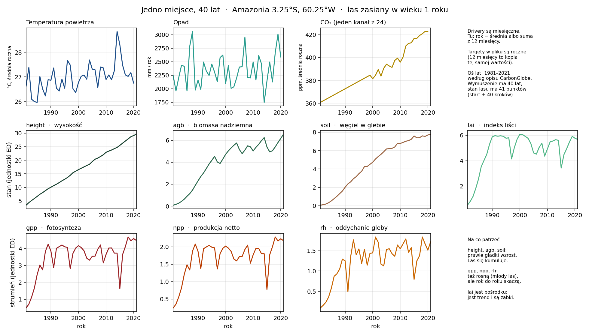

# CarbonGlobe Emulator — IEEE BigData Cup 2026: AI Emulation Challenge

An autoregressive machine-learning emulator of the Ecosystem Demography (ED) model — a process-based forest
carbon model used in NASA's Carbon Monitoring System and the Global Carbon Budget — built for the Kaggle
competition [IEEE BigData Cup 2026: AI Emulation Challenge](https://www.kaggle.com/competitions/ieee-bigdata-cup-2026-ai-emulation-challenge)
on the [CarbonGlobe](https://huggingface.co/datasets/zhwang1/CarbonGlobe) benchmark (NeurIPS 2025).

Given the initial state of a forest and 40 years of monthly environmental forcing, the model rolls the forest
forward one year at a time and predicts its state after four decades. Running ED itself at global scale took
~812 CPU-days; an emulator does it in minutes.

**Metric:** mean squared error of year-40 `height` and `agb`, each divided by its global mean
(`height / 10.90645`, `agb / 3.39567`) — i.e. the mean squared *relative* error at the end of the rollout.
Lower is better.



*One Amazon site (3.25°S, 60.25°W), seed age 1. Stocks (`height`, `agb`, `soil`) accumulate smoothly; fluxes
(`gpp`, `npp`, `rh`) and `lai` jump year to year with climate — note the joint dip around 2015–2016. An emulator
has to capture both regimes at once.*

## Approach and design decisions

### Autoregressive emulation, on purpose

Only the year-40 state is scored, so a direct regressor — `(initial state, 40-year climate summary) → y40` —
would be a legitimate shortcut with no error accumulation at all. I deliberately did not take it. The goal of
the challenge is to emulate ED's *dynamics*, and a step model is what makes an emulator reusable: arbitrary
horizons, intermediate years, new scenarios. The cost is drift, and the rest of the design is about
controlling it.

The model learns one annual transition, parameterized as a residual:

$$y_{t+1} = y_t + f_\theta\left(y_t,\ x_t,\ \mathrm{age}_t\right)$$

Predicting the increment instead of the next state matters: stocks such as height change by a small fraction of
their magnitude per year, so the network learns a small correction rather than re-deriving the whole state.

### One dataset for teacher forcing and rollout training

Each training sample is a segment of `k` consecutive years: the true state at year `t`, forcing for years
`t … t+k−1`, and the true states for `t+1 … t+k`. The model is unrolled `k` steps **on its own predictions**
and the loss is averaged over all steps.

- `k = 1` is plain teacher forcing: the model always starts from ground truth and never sees its own errors.
- Larger `k` exposes the model to its own accumulated error during training, which is exactly the regime it
  faces at test time.

The same `Dataset` and the same training loop cover both; switching regimes is a single config value.

### Validation mirrors the test protocol

Validation always runs the **full 40-year rollout** from the initial state only — the same information the
Kaggle test provides — and reports the competition metric. One-step error is deliberately not used for model
selection: it looks excellent even for models that drift badly over 40 steps.

### Site-level split

All 15 seed forest ages at a site share the same climate forcing. Splitting by sequence would put the same
site — and the same 40 years of weather — on both sides of the split. The split is done over sites, with all
15 seed ages kept together.

### Forest age as an explicit input

The forcing array has no age dimension: climate does not depend on how old the trees are. Age is therefore
fed to the model explicitly and advanced during the rollout: `age_t = (seed_age + t) / 500`.

### Seven numbers are not the full ED state

ED internally tracks the size and age structure of tree cohorts; the dataset exposes only 7 aggregates. Two
forests with identical height and biomass can evolve differently. Age partially stands in for the missing
structure; a recurrent latent state is the natural next step (see Roadmap).

### Built for an 8 GB laptop

The forcing tensor alone is 14 GB (`54152 × 40 × 12 × 136` float32), the labels another 11 GB. The pipeline:

- opens every array with `mmap_mode="r"`, so nothing is read until it is indexed;
- loads only a random subset of sites into RAM;
- collapses the label month axis — the 12 monthly values of each annual target are identical copies — which
  cuts label memory 12×.

### Distribution shift: historical training → future scenarios

Training covers historical climate (1981–2021). The Kaggle test uses future scenarios SSP1-2.6 and SSP5-8.5,
with higher CO₂ and temperature than anything in training (at the sites inspected, training CO₂ spans roughly
360–430 ppm). This is an extrapolation problem, which argues against tree-based models (they cannot predict
outside the training range of their inputs) and toward smooth function approximators.

## Results

Work in progress — full training runs are next. The table will report, on held-out sites with a 40-year
rollout:

| Setup | Score (val) |
| --- | --- |
| Persistence baseline (`y40 = y0`) | — |
| MLP step model, teacher forcing (`k = 1`) | — |
| MLP step model, rollout training | — |

## Roadmap

- **Rollout curriculum:** train with `k = 1 → 5 → 10 → 40`.
- **Noise injection** on the starting state, so the model learns to recover from slightly wrong inputs.
- **Physical constraints:** non-negative stocks and fluxes inside the rollout.
- **Loss weighting** toward the scored variables (`height`, `agb`).
- **Kaggle submission writer** for `test_ssp126.npz` / `test_ssp585.npz`.
- **Recurrent latent state** (GRU over years) and a monthly encoder instead of flattening 12 months.
- **Out-of-distribution validation:** hold out the hottest / highest-CO₂ sites to approximate the SSP shift.

## Data

Download CarbonGlobe from [Hugging Face](https://huggingface.co/datasets/zhwang1/CarbonGlobe) or
[Kaggle](https://www.kaggle.com/datasets/zhihaow/carbonglobe) (~29 GB) into `data/`:

```
data/
├── data_global/
│   ├── glob_X_fea.npy      (54152, 40, 12, 136)  forcing: site × year × month × driver
│   ├── glob_Y001.npy       (54152, 41, 12, 7)    states for seed age 1: site × year × month × target
│   └── ...                 one file per seed age, up to glob_Y500.npy
└── data_stats/
    └── data_stats.npz      x_mean, x_std, y_mean, y_std
```

Year 0 of each label array is the initial state; years 1–40 are the targets. Inputs and targets are normalized
per variable with the global statistics in `data_stats.npz` (the `height` and `agb` means there are exactly the
Kaggle scaling constants).

## Repository

```
main.py            # data loading, site split, dataset, step model, rollout training, validation
config.py          # all paths and hyperparameters
plot_one_site.py   # exploratory plot of one site (expects per-site slices of the raw arrays)
figures/           # generated plots
```

## Setup

```bash
pip install -r requirements.txt
```

PyTorch runs on Apple MPS if available, otherwise CPU.

## Train

```bash
python main.py
```

Prints the training loss and the 40-year-rollout validation score after every epoch and saves the best model
to `best_model.pt`. Settings live in `config.py`:

| Field | Default | Meaning |
| --- | --- | --- |
| `n_train_sites` / `n_val_sites` | 3000 / 500 | sites loaded into RAM |
| `val_frac` | 0.1 | fraction of sites held out |
| `k` | 1 | training segment length (rollout steps) |
| `batch_size` | 512 | samples per batch |
| `accum_steps` | 1 | gradient accumulation steps |
| `n_hidden` | 256 | hidden layer width |
| `lr` | 1e-3 | AdamW learning rate |
| `epochs` | 5 | training epochs |

## Metric

$$\mathrm{score} = \frac{1}{2}\left[\frac{1}{N}\sum_i \left(\frac{\hat h_i - h_i}{10.90645}\right)^2 + \frac{1}{N}\sum_i \left(\frac{\hat a_i - a_i}{3.39567}\right)^2\right]$$

where `h` and `a` are year-40 height and aboveground biomass over all (scenario, site, seed age) rows.
`sqrt(score)` is the relative RMSE.

## Citation

```bibtex
@inproceedings{wang2025carbonglobe,
  title     = {CarbonGlobe: A Global-Scale, Multi-Decade Dataset and Benchmark for Carbon Forecasting in Forest Ecosystems},
  author    = {Wang, Zhihao and Ma, Lei and Hurtt, George and Jia, Xiaowei and Li, Yanhua and Li, Ruohan and Li, Zhili and Xu, Shuo and Xie, Yiqun},
  booktitle = {Advances in Neural Information Processing Systems (NeurIPS), Datasets and Benchmarks Track},
  year      = {2025}
}
```
